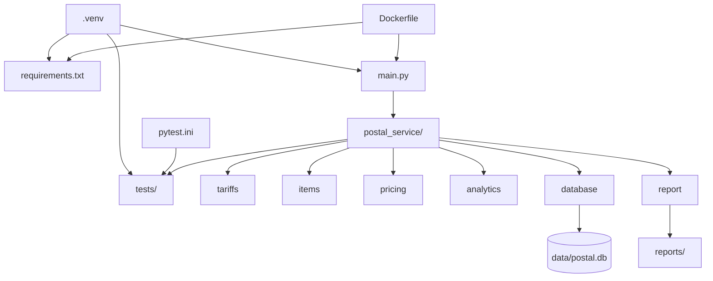
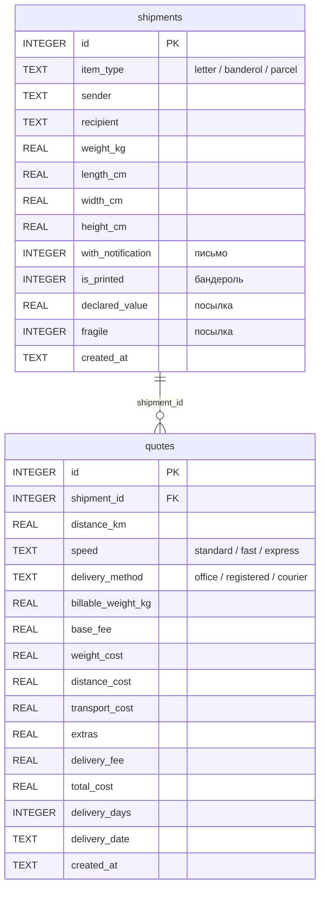

# Лабораторная работа №2. Почтовые отправления

Репозиторий с выполненной лабораторной работой по дисциплине "Теория алгоритмов", 3 курс. Вариант 6 - расчёт стоимости и срока доставки письма, бандероли и посылки.

## Требования

```bash
Python 3.10+
pip 23.2.1+
Docker
```

## Установка

```bash
git clone https://github.com/HolograficDev/python_lab2.git
cd python_lab2/python_lab_02
python -m venv .venv
.venv\Scripts\activate
pip install -r requirements.txt
```

## Запуск

```bash
python main.py                  # консольное приложение
python -m pytest -v             # тесты (67)
```

Запуск в Docker:

```bash
docker build -t postal-service .
docker run --rm -it -v postal-data:/app/data -v "${PWD}/reports:/app/reports" postal-service
docker run --rm postal-service python -m pytest -v    # тесты в контейнере
```

## Структура

| Модуль | Назначение                                     |
|---|------------------------------------------------|
| `main.py` | консольное меню, ввод и проверка данных        |
| `postal_service/tariffs` | срочность и тип доставки, округление денег     |
| `postal_service/items` | `PostalItem` : `Letter`, `Banderol`, `Parcel`  |
| `postal_service/pricing` | класс `Quote`: стоимость, срок и дата доставки |
| `postal_service/analytics` | сравнение вариантов, статистика расчётов       |
| `postal_service/database` | сохранение отправлений и расчётов в SQLite     |
| `postal_service/report` | отчёты Word (.docx) и Excel (.xlsx)            |
| `tests/` | тесты pytest                                   |

## Расчёт стоимости

Расчётная масса - большая из фактической и объёмной:

```math
m_{\text{расч}} = \max\left(m,\ \frac{L \cdot W \cdot H}{k}\right)
```

Тариф и стоимость перевозки с учётом срочности:

```math
T = F + m_{\text{расч}} \cdot r_{\text{кг}} + \frac{d}{100} \cdot r_{100}
```

```math
P = T \cdot c
```

Итоговая стоимость:

```math
S = P + E + f
```

Срок доставки в сутках:

```math
N = \max\left(1,\ \left\lceil \frac{d}{v} \right\rceil + h\right)
```

| Обозначение | Значение |
|---|---|
| $m$ | фактическая масса, кг |
| $L, W, H$ | длина, ширина, высота, см |
| $k$ | делитель объёмной массы (бандероль - 6000, посылка - 5000; для письма объём не учитывается) |
| $F$ | базовый сбор, руб. |
| $r_{\text{кг}}$ | плата за 1 кг расчётной массы, руб. |
| $r_{100}$ | плата за каждые 100 км, руб. |
| $d$ | расстояние, км |
| $c$ | коэффициент срочности (1,0 / 1,5 / 2,0) |
| $E$ | доплаты и скидки типа отправления, руб. |
| $f$ | плата за тип доставки (0 / 60 / 250 руб.) |
| $v$ | скорость доставки, км/сутки (400 / 700 / 1000) |
| $h$ | сутки на обработку (2 / 1 / 0) |

## Архитектура проекта



## Схема данных БД

Файл `data/postal.db` (SQLite) создаётся автоматически при первом запуске. Каждый расчёт в `quotes` ссылается на отправление из `shipments` (внешний ключ, `PRAGMA foreign_keys = ON`).

